
<strong>CFGS Administración de Sistemas Informáticos y en Red (1º curso)</strong>

Material elaborado para el módulo **Fundamentos de Hardware**

# UT2.2. Procesadores y memoria

## Programación de Aula

### Resultados de Aprendizaje

Esta unidad forma parte de la UT2 "Elementos internos de un sistema informático" y trabaja el **Resultado de Aprendizaje 1 (RA1)** del módulo, según el **Real Decreto 1629/2009** (Anexo I, módulo *Fundamentos de Hardware*):

1. **RA1.** Configura equipos microinformáticos, componentes y periféricos, analizando sus características y relación con el conjunto.

Criterios de evaluación que trabaja esta unidad (junto con UT2.1 y UT2.3):

- **CE11** (RA1.a): Se han identificado y caracterizado los dispositivos que constituyen los bloques funcionales de un equipo microinformático.
- **CE13** (RA1.c): Se ha analizado la arquitectura general de un equipo y los mecanismos de conexión entre dispositivos.
- **CE14** (RA1.d): Se han establecido los parámetros de configuración (hardware y software) de un equipo microinformático con las utilidades específicas.
- **CE18** (RA1.h): Se han clasificado los dispositivos periféricos y sus mecanismos de comunicación.

### Planificación Temporal (2 sesiones / 4 horas)

| Sesión | Contenido |
| ------ | --------- |
| 1 | Arquitectura de procesadores: fabricación, instrucciones, partes, núcleos e hilos, caché, consumo y overclocking |
| 2 | Memoria: caché y RAM, tipos, parámetros, cálculos y dual channel |

!!! info "Fuentes y licencia"
    Este tema adapta el documento *UT2.2 Procesadores y memoria* de **Daniel López Escuder** (Fundamentos de Hardware – ASIX), publicado bajo licencia **Creative Commons Reconocimiento-NoComercial-CompartirIgual 4.0 (CC BY-NC-SA 4.0)**. Por respeto a dicha licencia, este material se comparte con las mismas condiciones. Las imágenes proceden del documento original. Bibliografía del original: Profesional Review, HardZone, apuntes de Fundamentos de Hardware de Francisco de Asís González Cavero, *Montaje y mantenimiento de equipos* (Paraninfo, 3ª ed.) y apuntes de la Universitat Jaume I.

## 1. Introducción

El **microprocesador** es el auténtico cerebro de todos los elementos del PC. La función principal de la CPU es ejecutar los programas almacenados en la memoria principal del PC, leyendo las instrucciones, decodificándolas y realizando las acciones asociadas a cada una de ellas.

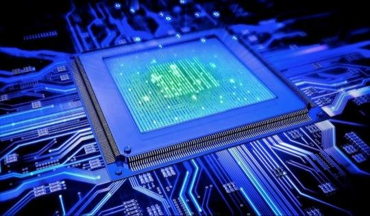

<em>El microprocesador: un chip con miles o millones de transistores</em>

El microprocesador es un chip, un componente electrónico cuyo interior está compuesto por miles de millones de transistores, cuya combinación permite ejecutar las instrucciones de los programas. Suelen tener forma cuadrada o rectangular y, en los equipos de sobremesa, se instalan sobre un elemento llamado zócalo (socket), específico de cada familia de procesadores, que los conecta a la placa base mediante pines o contactos. En muchos portátiles, en cambio, el procesador va soldado directamente a la placa. Además, es necesario acompañarlo de un sistema de refrigeración que ayude a disipar el calor; para mejorar la transmisión del calor entre el procesador y el disipador se aplica pasta térmica.

Hemos de tener en cuenta que la información se representa mediante señales eléctricas que viajan por los circuitos. Los datos y programas se almacenan en la memoria principal (RAM), y el procesador los lleva a pequeñas memorias internas muy rápidas (registros y caché) para procesarlos.

## 2. Arquitectura de procesadores

A medida que avanzan las tecnologías, la CPU que estudiamos en la arquitectura de Von Neumann ha ido evolucionando hasta el esquema siguiente. Hoy en día, los procesadores tienen varios **núcleos**, los cuales pueden acceder a la memoria caché integrada dentro del microprocesador.

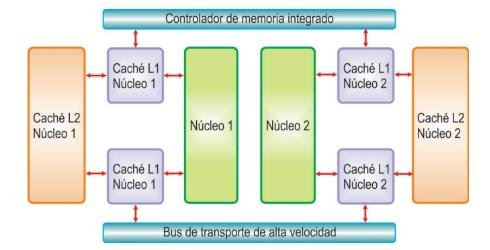

<em>Esquema de un procesador con dos núcleos, cachés L1 y L2 y controlador de memoria integrado</em>

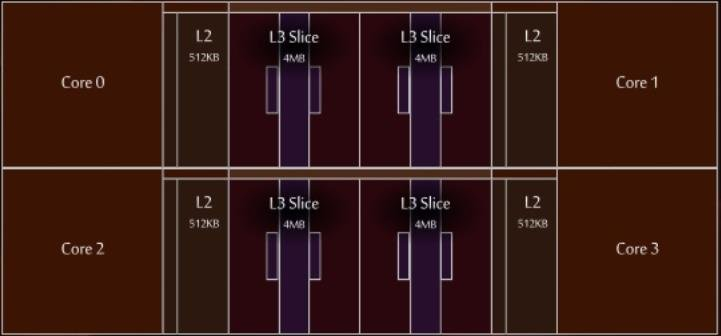

<em>Ejemplo: distribución interna de un procesador Zen 3 (cuatro núcleos, caché L2 y L3)</em>

### 2.1 Proceso de fabricación

El proceso de fabricación es básicamente el **tamaño de los transistores** que forman el procesador. Desde las válvulas de vacío de las primeras computadoras hasta los transistores **FinFET** actuales, fabricados por empresas como TSMC y Global Foundries, de solo unos nanómetros, la evolución ha sido enorme.

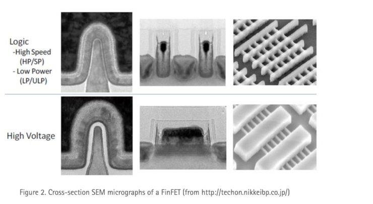

<em>Sección transversal de un transistor FinFET (micrografía electrónica)</em>

Un procesador está formado por transistores, las unidades más pequeñas que encontramos en su interior. Un transistor es un elemento que permite o no pasar corriente: 0 (no corriente), 1 (corriente). Actualmente miden 14 nm o 7 nm o menos (1 nm = 0,000000001 m). Con los transistores se crean **puertas lógicas**, y con las puertas lógicas se crean los **circuitos integrados** capaces de realizar distintas funciones.

### 2.2 Juego de instrucciones

Una parte importante de diseñar un procesador es elegir cuál será su **juego de instrucciones**, que junto con los registros utilizados forma su arquitectura. Esta decisión es importante porque determina el comportamiento funcional del sistema por dos motivos:

- El juego de instrucciones decide el diseño físico del conjunto.
- Cualquier operación a ejecutar debe ser escrita en términos de un lenguaje de estas instrucciones.

Existen varias filosofías de arquitectura de procesadores:

- **CISC**: ofrece un conjunto de instrucciones completas y lentas de ejecutar, que agrupan varias operaciones de bajo nivel en la misma instrucción. Esto da lugar a programas pequeños y sencillos de desarrollar que realizan pocos accesos a memoria. En la actualidad, CISC tiene a **x86** como su mayor exponente, con AMD y sobre todo Intel a la cabeza. Hay muchos ejemplos históricos, como los PDP, Motorola 68000, Intel 4004 o Intel 8086.
- **RISC**: ofrece un conjunto de instrucciones muy simples que se ejecutan más rápidamente. El catálogo es de pocas instrucciones muy sencillas, lo que implica que hacen falta más de ellas: el programa final es más largo y accede más veces a los datos almacenados en memoria. En la actualidad, el mayor ejemplo de procesador RISC son los productos **ARM**, muy utilizados en dispositivos móviles.
- **Híbrido CISC/RISC**: recoge lo mejor de ambas. Internamente, el procesador lleva a cabo solo instrucciones simples. Sobre estas instrucciones internas hay un circuito decodificador que convierte las instrucciones complejas utilizadas por los programas en varias instrucciones simples que el procesador puede entender.

La gran batalla actual es la que libran las dos principales arquitecturas de procesadores: ARM y x86. ARM, de tipo RISC (juego de instrucciones reducido), se ha caracterizado tradicionalmente por su eficiencia energética, lo que la ha convertido en la arquitectura dominante en móviles y tablets. x86, de tipo CISC (juego de instrucciones complejo) y fabricada principalmente por Intel y AMD, ha destacado históricamente por su alto rendimiento en ordenadores personales y servidores, a costa de un mayor consumo.

Sin embargo, esta frontera es cada vez más difusa. Procesadores ARM como los Apple M o los Snapdragon X ofrecen ya un rendimiento comparable al de los x86, y los fabricantes de x86 han mejorado notablemente su eficiencia. Hoy, el consumo y el rendimiento dependen tanto del diseño concreto del chip y de su proceso de fabricación como de la arquitectura en sí.

### 2.3 Partes del microprocesador

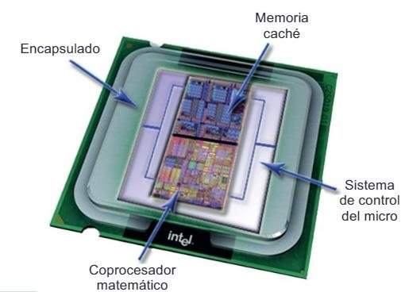

<em>Partes de un microprocesador: encapsulado, memoria caché, sistema de control y coprocesador matemático</em>

* **Encapsulado**: envoltorio físico de plástico, cerámica o resina que rodea el chip de silicio para protegerlo y permitir su conexión con el zócalo. Incluye los contactos eléctricos para la alimentación y la transmisión de datos y, en su parte superior, una placa metálica (IHS) que transmite el calor hacia el disipador.
* **Memoria caché**: memoria ultrarrápida integrada en el procesador que almacena los datos e instrucciones que previsiblemente se usarán con más frecuencia, evitando accesos a la RAM, mucho más lenta. Se organiza en niveles según su ubicación, velocidad y tamaño:
    * **Caché L1**: la más rápida y pequeña. Cada núcleo tiene la suya, normalmente dividida en caché de instrucciones y caché de datos.
    * **Caché L2**: más lenta que la L1, pero de mayor capacidad. En los procesadores actuales suele ser privada de cada núcleo.
    * **Caché L3**: más grande y lenta que las anteriores, y compartida por todos los núcleos. Agiliza el acceso a los datos e instrucciones que no se encontraron en L1 ni en L2.
    * **Caché L4**: poco habitual; se ha utilizado en algunos procesadores, por ejemplo como apoyo a la GPU integrada.
* **FPU (Floating Point Unit)**: unidad especializada en operaciones en coma flotante (números reales). Antiguamente era un chip independiente (coprocesador matemático); hoy está integrada en cada núcleo.
* **Unidad de control (UC)**: busca las instrucciones en memoria, las decodifica y coordina su ejecución enviando señales de control al resto de componentes. También gestiona las interrupciones.
* **ALU (Unidad Aritmético-Lógica)**: realiza las operaciones aritméticas y lógicas con números enteros.
* **Registros**: pequeñas memorias de acceso muy rápido dentro del procesador donde se guardan los datos e instrucciones de las operaciones en curso. Pueden ser de uso general o específico (contador de programa, registro de instrucción, acumulador…).
* **iGPU (Integrated Graphics Processing Unit)**: unidad gráfica integrada en el propio procesador. Al no disponer de memoria propia, comparte la RAM del sistema; la cantidad reservada para gráficos se configura en la BIOS/UEFI o la asigna el sistema operativo de forma dinámica.

Las CPU tienen una serie de características que usamos para clasificarlas y compararlas.

!!! warning "Importante"
    La velocidad de un procesador no es el único indicativo para medir la rapidez, el número de instrucciones que procesa por unidad de tiempo, sino que intervienen otros parámetros como el número de núcleos, la arquitectura, la caché y, por supuesto, la frecuencia.

#### 2.4.1 Número de núcleos

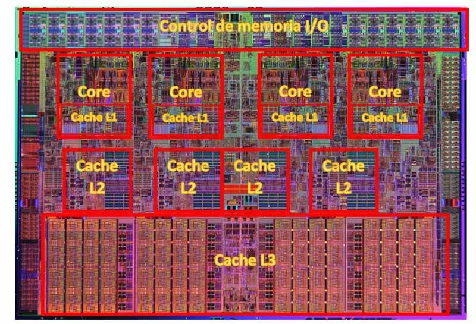

<em>Fotografía de la pastilla de silicio de un procesador con varios núcleos y caché L3</em>

Los núcleos son las unidades de procesamiento de información del microprocesador. Cada núcleo contiene los componentes básicos necesarios para ejecutar instrucciones: la unidad de control (UC), el decodificador de instrucciones, la unidad aritmético-lógica (ALU), la unidad de coma flotante (FPU), los registros y la memoria caché de primer y segundo nivel (L1 y L2).

Cada núcleo es capaz de ejecutar instrucciones de forma independiente. Los procesadores actuales pueden ejecutar varias instrucciones por cada ciclo de reloj, lo que se mide mediante el IPC (instrucciones por ciclo). La frecuencia de reloj, medida en hercios (Hz), indica cuántos ciclos se producen por segundo. Por tanto, el rendimiento de un núcleo depende tanto de su frecuencia como de su IPC: a igualdad de arquitectura, más Hz implican más instrucciones por segundo, y más núcleos permiten realizar más operaciones simultáneamente, siempre que el software esté preparado para aprovecharlos. Además, muchos procesadores incorporan SMT (Hyper-Threading, en Intel), que permite a cada núcleo ejecutar dos hilos a la vez.

No todos los núcleos tienen por qué ser iguales: los diseños híbridos, como los de Intel (núcleos P de rendimiento y núcleos E de eficiencia) o ARM (big.LITTLE), combinan núcleos de distinto tipo para equilibrar rendimiento y consumo.

En la actualidad, los fabricantes construyen sus procesadores de forma modular, uniendo varios bloques de silicio. AMD utiliza chiplets llamados CCD (Core Complex Die), cada uno con 8 núcleos en sus modelos Ryzen recientes, junto a un chiplet independiente de entrada/salida (IOD). Este sistema mejora la escalabilidad: basta con combinar varios CCD para conseguir el número de núcleos deseado. Además, el fabricante puede desactivar núcleos para crear modelos de gama inferior. Intel, que durante años fabricó sus procesadores en un único bloque de silicio, también ha adoptado un diseño modular basado en tiles desde sus procesadores Core Ultra.

#### 2.4.2 Control de voltaje

**Turbo Boost** y **Precision Boost Overdrive** son los sistemas que utilizan Intel y AMD, respectivamente, para controlar el voltaje de sus procesadores de forma activa e inteligente. Esto les permite aumentar la frecuencia de trabajo como si de un *overclocking* automático se tratase, para que la CPU rinda más ante una gran carga de tareas. Ayuda además a mejorar la eficiencia térmica y el consumo, al poder variar la frecuencia cuando sea necesario.

#### 2.4.3 Hilos de procesamiento o *threads*

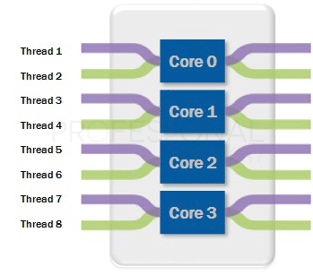

<em>Ocho hilos repartidos entre cuatro núcleos</em>

En un procesador no solo tenemos núcleos: también existen los **hilos de procesamiento**. Normalmente los veremos representados en las especificaciones como *X Cores / X Threads* (X C / X T). Por ejemplo, un Intel Core i9-9900K tiene 8C/16T, mientras que un i5-9400 tiene 6C/6T.

El término *thread* viene de «subproceso», y no forma parte físicamente del procesador: su funcionalidad es puramente lógica y se realiza mediante el conjunto de instrucciones del procesador. Se puede definir como el flujo de control de datos de un programa (un programa está formado por instrucciones o procesos), que permite administrar las tareas de un procesador dividiéndolas en trozos más pequeños llamados subprocesos. Así se pretende optimizar los tiempos de espera de cada instrucción en la cola de proceso.

Hay tareas más difíciles que otras, por lo que un núcleo tardará más o menos tiempo en terminarlas. Con los hilos, esa tarea se divide en algo más simple para que cada trozo sea procesado por el primer núcleo libre que se encuentre. El resultado es mantener continuamente los núcleos ocupados, sin tiempos muertos.

#### 2.4.4 Tecnologías multithreading

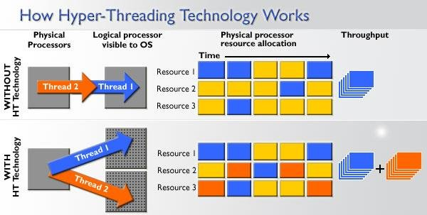

<em>Funcionamiento de la tecnología Hyper-Threading</em>

¿Por qué en unos procesadores vemos el mismo número de núcleos que de hilos y en otros no? Se debe a la tecnología SMT (Simultaneous Multithreading o multihilo simultáneo), que algunos fabricantes implementan en sus procesadores.

Un hilo es una secuencia de instrucciones que el procesador ejecuta. Sin SMT, cada núcleo ejecuta un solo hilo a la vez, por lo que el número de hilos coincide con el de núcleos. Con SMT, cada núcleo puede ejecutar dos hilos simultáneamente compartiendo sus recursos internos (ALU, FPU, caché…): aprovecha los momentos en que una parte del núcleo quedaría inactiva, por ejemplo esperando un dato de la memoria, para avanzar con el otro hilo. El sistema operativo ve cada hilo como un procesador lógico, por lo que un procesador de 8 núcleos con SMT aparece como 16 procesadores lógicos.

En los procesadores de ordenador personal, el SMT permite ejecutar dos hilos por núcleo, aunque existen procesadores de servidor que admiten 4 u 8. Intel llama a su implementación Hyper-Threading, mientras que AMD la denomina simplemente SMT; en la práctica, ambas funcionan de forma similar.

No todos los procesadores incorporan esta tecnología. Muchos modelos de gama baja, la mayoría de procesadores ARM (como los Apple M) y los Intel Core Ultra más recientes carecen de ella, por lo que tienen el mismo número de núcleos que de hilos. En los procesadores híbridos de Intel, solo los núcleos de rendimiento (P) tienen Hyper-Threading, de modo que el número de hilos no llega al doble del de núcleos: por ejemplo, el Core i9-13900K tiene 24 núcleos y 32 hilos.

Hay que tener en cuenta que un hilo no equivale a un núcleo físico: el SMT suele mejorar el rendimiento en torno a un 15-30 %, no lo duplica. Por ello, a igual frecuencia, un procesador con 8 núcleos físicos es más rápido que uno con 4 núcleos y 8 hilos.

#### 2.4.5 Memoria caché

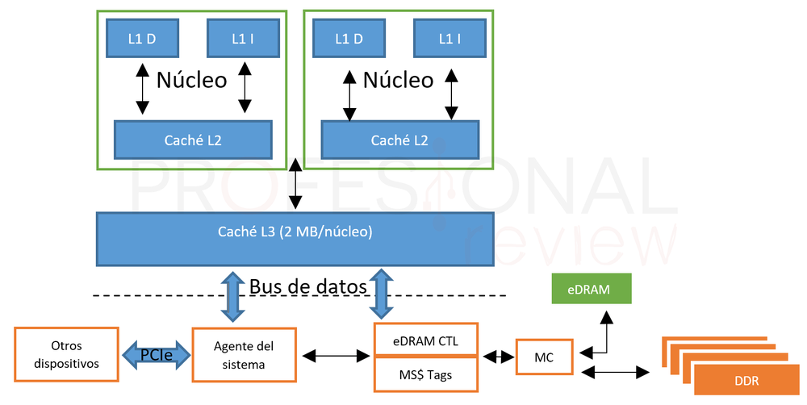

<em>Esquema de la memoria caché dentro del procesador y su conexión con la RAM</em>

La memoria caché es uno de los elementos más importantes de un procesador. Está integrada en el propio procesador y es mucho más rápida que la memoria RAM. Por ejemplo, en un Ryzen 3000, mientras que una RAM DDR4-3600 en doble canal alcanza unos 50 GB/s en lectura, la caché L3 puede superar los 500 GB/s, la L2 los 750 GB/s y la L1 los 1500 GB/s (cifras que suman todos los núcleos y varían según el modelo).

La caché utiliza memoria SRAM (Static RAM), mientras que la RAM utiliza DRAM (Dynamic RAM). La DRAM almacena cada bit en un condensador, que se descarga con el tiempo y necesita una señal de refresco continua; al necesitar muy pocos componentes por bit, es densa y barata, pero más lenta. La SRAM necesita unos seis transistores por bit y no requiere refresco: es mucho más rápida, pero también más cara y ocupa más espacio, por lo que la caché tiene una capacidad reducida.

En la caché se almacenan los datos e instrucciones que el procesador predice que va a necesitar, basándose en el principio de localidad: un dato usado recientemente probablemente se vuelva a usar pronto, al igual que los datos cercanos a él en memoria. Así se reducen los accesos a la RAM y se optimiza el tiempo de proceso. En los procesadores actuales de AMD e Intel existen tres niveles de caché:

* **L1**: la más cercana a los núcleos, la más pequeña y la más rápida, con latencias en torno a 1 ns. Cada núcleo tiene la suya propia, dividida en dos: L1I (instrucciones) y L1D (datos). En los Intel Core de 9.ª generación y los Ryzen 3000 es de 32 KB cada una.
* **L2**: el siguiente nivel, con latencias en torno a 3 ns, también independiente para cada núcleo. Su tamaño ha crecido con cada generación: de 256 KB en los Intel Core de 9.ª generación y 512 KB en los Ryzen 3000 a 1 MB en los Ryzen actuales y 2-3 MB en los núcleos de rendimiento de Intel más recientes.
* **L3**: la de mayor tamaño (desde varios MB hasta decenas de MB) y la más lenta de las tres, con latencias en torno a 10 ns. Se comparte entre varios núcleos: en Intel, entre todos ellos; en AMD, entre los núcleos de cada CCX (grupos de 4 en los Ryzen 3000 y de 8 a partir de los Ryzen 5000).

Cuando el procesador necesita un dato, lo busca primero en L1, después en L2, luego en L3 y, por último, en la RAM. Se produce un acierto de caché (hit) cuando el dato se encuentra en la caché, y un fallo de caché (miss) cuando no está y hay que buscarlo en el nivel siguiente. Al recuperarlo, el dato se copia a los niveles superiores para tenerlo más a mano la próxima vez. Cuando la caché se llena, se sustituyen normalmente los datos que llevan más tiempo sin usarse.

#### 2.4.6 Buses

En las placas base antiguas, el puente norte (northbridge) era el chip encargado de conectar el procesador con la memoria RAM, la tarjeta gráfica y el puente sur. En la actualidad, AMD e Intel integran el controlador de memoria (IMC, Integrated Memory Controller) dentro de la propia CPU, junto con las líneas PCIe destinadas a la tarjeta gráfica. En los procesadores basados en chiplets, como los Ryzen, el controlador de memoria se encuentra en el chiplet de entrada/salida (IOD).

Esto aumenta significativamente la velocidad de acceso a la memoria y simplifica el diseño de las placas base, que conservan solo el antiguo puente sur, al que llamamos chipset (Intel lo denomina PCH, Platform Controller Hub). El chipset gestiona las conexiones de los discos SATA, los puertos USB, la red, el audio y algunas ranuras PCIe y M.2, mientras que la ranura PCIe principal de la tarjeta gráfica y el primer M.2 suelen conectarse directamente a la CPU.

Los procesadores de escritorio actuales utilizan memoria DDR5 en doble canal, con velocidades oficiales de entre 5600 y 6400 MT/s según el modelo, y admiten hasta 192 GB de RAM o más. Estas velocidades oficiales corresponden a los perfiles estándar JEDEC; los perfiles XMP (Intel) y EXPO (AMD) permiten configurar la memoria a velocidades superiores mediante overclock.

Según la información que transportan, los buses del sistema se dividen en:

* **Bus de datos**: transporta los datos e instrucciones de los programas.
* **Bus de direcciones**: transporta las direcciones de las posiciones de memoria donde se leen o escriben los datos.
* **Bus de control**: transporta las señales que coordinan el funcionamiento del sistema (lectura, escritura, interrupciones, reloj…).

Históricamente, también se distinguía entre:

* **FSB (Front-Side Bus)**: conectaba el procesador con el puente norte. Fue sustituido por enlaces más rápidos como QuickPath Interconnect (Intel) e HyperTransport (AMD), que a su vez han quedado obsoletos. Hoy Intel conecta la CPU con el chipset mediante DMI, y AMD mediante líneas PCIe.
* **BSB (Back-Side Bus)**: conectaba el procesador con la caché L2 cuando esta se encontraba fuera del núcleo. Desapareció al integrarse la caché en el propio procesador.

Dentro del procesador actual, los distintos componentes se comunican mediante interconexiones internas: AMD utiliza Infinity Fabric para unir sus chiplets, e Intel utiliza un bus en anillo (Ring Bus) para conectar los núcleos, la caché L3 y la gráfica integrada.

#### 2.4.7 iGPU: procesador gráfico integrado

Muchos procesadores actuales integran una unidad gráfica (iGPU) destinada al procesamiento de gráficos, la decodificación de vídeo y, cada vez más, a tareas de cálculo e inteligencia artificial. Intel y AMD la incorporan en buena parte de sus procesadores para ordenadores, y fabricantes como Qualcomm (con sus gráficas Adreno) la integran en los chips de los smartphones. AMD denomina a sus procesadores con gráfica integrada **APU** (*Accelerated Processing Unit*), mientras que en móviles y otros dispositivos se habla de **SoC** (*System on a Chip*), ya que integran en un solo chip la CPU, la GPU y otros componentes.

La razón de incluir una GPU es que el procesamiento gráfico requiere un tipo de cálculo muy distinto al del resto de tareas. Una CPU dispone de pocos núcleos muy potentes, pensados para ejecutar instrucciones de forma secuencial, mientras que una GPU dispone de cientos o miles de núcleos más sencillos que trabajan en paralelo, ideales para calcular a la vez los millones de píxeles que forman una imagen. Integrar la GPU en el procesador permite prescindir de una tarjeta gráfica dedicada, reduciendo el coste, el consumo y el espacio. Su principal limitación es que no dispone de memoria propia: comparte la RAM del sistema con la CPU, que es mucho más lenta que la memoria GDDR de las tarjetas gráficas dedicadas.

La potencia de una GPU se mide por la cantidad de núcleos y su frecuencia de trabajo, así como por otros elementos:

* **Unidades de sombreado** (*shaders*): son los núcleos de la GPU, encargados de calcular la geometría, la iluminación y el color de cada píxel. Cada fabricante les da un nombre propio y los agrupa en unidades mayores (Compute Units en AMD, núcleos Xe en Intel).
* **TMU** (*Texture Mapping Units*): unidades de texturizado, que aplican las texturas sobre los objetos.
* **ROP** (*Render Output Units*): unidades de salida de renderizado, que componen y escriben en memoria el resultado final de cada píxel.

Además, el rendimiento gráfico depende en gran medida del ancho de banda de la memoria a la que tiene acceso la GPU.

### 2.5 Socket

Fuera de los componentes de una CPU, tenemos dónde conectarla: el **zócalo o socket**, un gran conector ubicado en la placa base y provisto de cientos de pines que hacen contacto con la CPU para trasladarle la energía y los datos a procesar. Cada fabricante tiene sus propios sockets, y pueden ser de varios tipos:

- **LGA** (*Land Grid Array*): los pines están instalados directamente en el socket de la placa y la CPU solo cuenta con contactos planos. Permite mayor densidad de conexiones y lo usa Intel (por ejemplo LGA 1151 en escritorio y LGA 2066 en estaciones de trabajo). También lo usa AMD en sus Threadripper (TR4).
- **PGA** (*Pin Grid Array*): justo lo contrario, los pines están en la propia CPU y el socket tiene huecos. Lo usa AMD todavía en sus Ryzen de escritorio (AM4).
- **BGA** (*Ball Grid Array*): un «socket» en el que se suelda directamente el procesador. Se usa en los portátiles de nueva generación, tanto de AMD como de Intel.

### 2.6 Consumo

El **consumo** es la energía que gasta el procesador. Para hallarlo: **tensión (V) × intensidad (A)**.

- **Voltaje**: tensión de alimentación.
- **Corriente**: cantidad de electricidad que circula por un conductor.
- **Consumo**: se expresa en vatios (W).

Hay tecnologías que hacen que el procesador no consuma cuando no tiene nada que procesar (por ejemplo, **Cool'n'Quiet** de AMD).

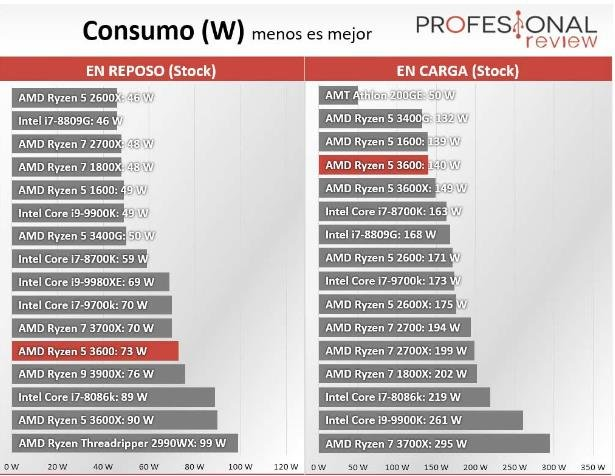

<em>Comparativa de consumo de procesadores en reposo y en carga</em>

!!! example "Ejemplos"
    - i7 → 1,25 V; 90 A → consumo: 1,25 V × 90 A = **112,5 W**.
    - Ryzen 5 → 1,15 V; 70 A → consumo: 1,15 V × 70 A = **80,5 W**.
    - ¿Voltaje de un procesador que consume 95 W y 80 A? Voltaje = consumo ÷ intensidad = 95 ÷ 80 = **1,19 V**.

#### 2.6.1 Control de temperatura

El *thermal throttling* es un sistema de protección automático que tienen las CPU para disminuir el voltaje y la potencia suministrada cuando las temperaturas llegan al máximo admisible. De esta forma se baja la frecuencia de trabajo y también la temperatura, estabilizando el chip para que no se queme. Los propios fabricantes ofrecen datos de las temperaturas de sus procesadores:

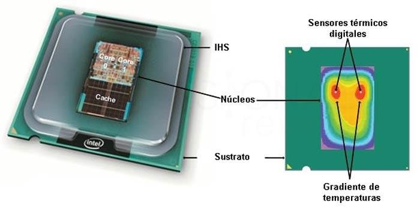

<em>Sensores térmicos digitales, IHS, núcleos y gradiente de temperaturas en un procesador</em>

- **TjMax**: temperatura máxima que un procesador es capaz de aguantar en su matriz, es decir, dentro de sus núcleos. Cuando la CPU se acerca a ella salta la protección que baja el voltaje y la potencia.
- **Tdie, Tjunction o temperatura de unión**: se mide en tiempo real por sensores colocados en el interior de los núcleos. Nunca superará TjMax, ya que el sistema de protección actúa antes.
- **TCase**: temperatura medida en el **IHS** (difusor térmico integrado) del procesador, es decir, en su encapsulado; siempre es distinta a la que se marca dentro de un núcleo.
- **CPU Package**: promedio de la temperatura de unión de todos los núcleos de la CPU.

### 2.7 Resumen de tecnologías asociadas
**Intel**

- **Hyper-Threading**: implementación de Intel de la tecnología SMT, que permite a cada núcleo ejecutar dos hilos simultáneamente; el sistema operativo ve cada núcleo como dos procesadores lógicos. Ha sido eliminada en los Intel Core Ultra más recientes.
- **QuickPath Interconnect (QPI)**: conexión punto a punto entre procesadores y con el chipset (de 4,8 a 6,4 GT/s en su primera versión), que sustituyó al FSB. Actualmente está obsoleta: ha sido reemplazada por UPI (entre procesadores en servidores) y DMI (entre la CPU y el chipset).
- **Turbo Boost**: aumenta automáticamente la frecuencia de los núcleos cuando la carga de trabajo lo requiere, siempre que la temperatura y el consumo lo permitan.
- **SpeedStep**: ajusta la frecuencia y el voltaje del procesador según la carga de trabajo, reduciendo el consumo y el calor. Su evolución, **Speed Shift**, permite que sea el propio procesador quien gestione estos cambios, de forma más rápida.
- **Quick Sync**: codifica y decodifica vídeo por hardware mediante la gráfica integrada.
- **Gráficos integrados**: GPU integrada en el procesador, conocida como HD Graphics, UHD Graphics, Iris Xe y, en los Core Ultra, Intel Graphics o Arc.

**AMD**

- **SMT** (*Simultaneous Multithreading*): equivalente al Hyper-Threading de Intel; permite a cada núcleo ejecutar dos hilos. Se utiliza desde los procesadores Ryzen (2017). Anteriormente, los procesadores Bulldozer usaban **CMT** (*Clustered Multithreading*), en la que cada módulo contenía dos núcleos que compartían la FPU y otros recursos.
- **Infinity Fabric**: interconexión de alta velocidad que une los distintos chiplets del procesador. Sustituyó a **HyperTransport**, la conexión punto a punto equivalente a QuickPath.
- **Precision Boost**: aumenta automáticamente la frecuencia de los núcleos según la carga, la temperatura y el consumo, equivalente al Turbo Boost de Intel. Sustituyó a **Turbo Core**.
- **Cool'n'Quiet**: reduce la frecuencia y el voltaje del procesador cuando la carga de trabajo es baja, disminuyendo el consumo y el calor; equivalente a SpeedStep.
- **VCN** (*Video Core Next*): codifica y decodifica vídeo por hardware, equivalente a Quick Sync.
- **Radeon Graphics**: GPU integrada en las APU y en los procesadores Ryzen actuales.

### 2.8 Overclocking

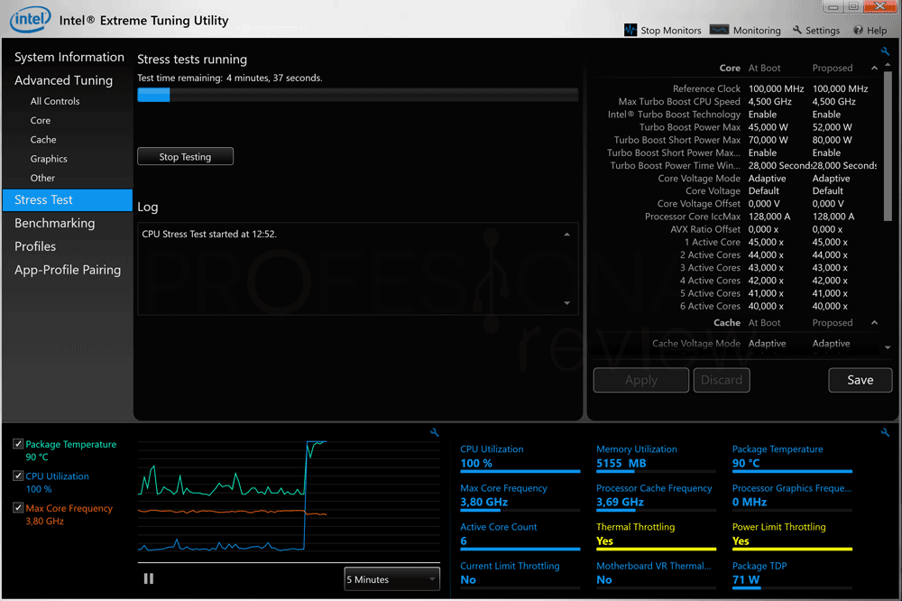

<em>Herramienta Intel Extreme Tuning Utility (XTU) para ajustar frecuencia y voltaje</em>

El overclocking es una técnica que consiste en aumentar la frecuencia de funcionamiento de la CPU por encima de los valores establecidos por el fabricante, incluidos los del modo turbo. La frecuencia del procesador se obtiene multiplicando el reloj base (BCLK) por el multiplicador (por ejemplo, 100 MHz × 45 = 4,5 GHz), por lo que puede aumentarse modificando cualquiera de los dos valores. A menudo también es necesario aumentar el voltaje para que el procesador funcione de forma estable. Es una práctica que supone un riesgo para la estabilidad y la vida útil del procesador, y que puede suponer la pérdida de la garantía.

!!! warning "Importante"
    No existe un margen de overclock seguro para todos los procesadores: depende de cada chip. Los procesadores actuales ya trabajan cerca de su límite, por lo que se recomienda subir la frecuencia de forma gradual y comprobar la estabilidad en cada paso.

Para realizar overclock modificando el multiplicador, se necesita un procesador con el multiplicador desbloqueado y una placa base cuyo chipset lo permita. En AMD, casi todos los Ryzen de escritorio tienen el multiplicador desbloqueado, y lo admiten los chipsets de las series B y X (como B650, X670, B850 o X870). En Intel, solo los procesadores con sufijo K (K, KF y KS) y los chipsets de la serie Z (como Z790 o Z890).

El overclocking también puede realizarse aumentando la frecuencia del reloj base o BCLK (normalmente de 100 MHz), del que dependen la CPU y la memoria RAM. Este método permite aumentar la frecuencia incluso en procesadores con el multiplicador bloqueado, pero es más arriesgado e inestable, ya que puede afectar a otros componentes.

El undervolting, por su parte, consiste en reducir el voltaje del procesador manteniendo su frecuencia. Así se disminuyen la temperatura y el consumo, lo que ayuda a evitar el thermal throttling (reducción automática de la frecuencia por exceso de temperatura) y a mantener el modo turbo durante más tiempo. Es muy habitual en portátiles y tarjetas gráficas. Si se reduce demasiado el voltaje, el equipo puede volverse inestable.

| Consecuencias negativas | Consecuencias positivas |
|---|---|
| Inestabilidad del sistema (cuelgues, pantallazos azules, reinicios) | Mayor rendimiento sin coste adicional |
| Mayor temperatura y consumo | |
| Reducción de la vida útil o daños por voltaje excesivo | |
| Pérdida de la garantía | |

**Consejos:**

* Utilizar un buen sistema de refrigeración.
* Subir la frecuencia de forma gradual.
* Aumentar el voltaje solo si es necesario y sin superar los valores recomendados.
* Realizar pruebas de estrés (Prime95, OCCT, Cinebench) para comprobar la estabilidad.
* Vigilar las temperaturas con programas de monitorización (como HWiNFO).
* Contar con componentes de calidad, especialmente la placa base y la fuente de alimentación.

Actualmente, los fabricantes solo permiten el overclocking en determinados modelos, bloqueando el multiplicador en el resto. Además, los procesadores modernos ajustan automáticamente su frecuencia hasta casi su máximo (Turbo Boost, Precision Boost), por lo que la ganancia que se obtiene con el overclocking manual es cada vez menor.

### 2.9 Tipos de microprocesadores

- **Superescalares**: capaces de ejecutar más de una instrucción por ciclo de reloj.
- **Coprocesadores**: procesador que ayuda al procesador principal a procesar tareas complejas, aumentando su rendimiento.
- **DSP** (procesadores de señales digitales): ayudan a codificar/decodificar vídeos en tiempo real y a convertir señales digitales en analógicas y viceversa.
- **IOP** (procesador de E/S): controla y administra las tareas de entrada/salida.
- **GPU**: diseñado específicamente para acelerar el proceso de creación de imágenes; ejecuta las instrucciones en paralelo, razón por la cual es más rápido que la CPU para esta tarea.
- **SoC** (*System on Chip*): procesadores soldados a la placa base, habituales en portátiles y consolas.

### 2.10 Procesadores recientes

<em>Cómo leer el nombre de un procesador Intel: marca, modificador, indicador de generación y sufijo</em>

**Intel** se mantiene fiel a la microarquitectura de **núcleo monolítico**, lo que significa que todos los núcleos del procesador se integran en una única pastilla de silicio. Últimas arquitecturas (según el documento):

- **Rocket Lake-S**: basada en el proceso de 14 nm++, en las gamas Core i5, i7 e i9 de 11ª generación (serie 11xxx). Hasta 8 núcleos y 16 hilos.
- **Cascade Lake-X**: basada en 14 nm++, en los Core i7 e i9 serie 10000X y Xeon, con hasta 18 núcleos y 34 hilos.

**AMD** utiliza una microarquitectura **MCM** (módulo multichip), lo que significa que los núcleos pueden quedar repartidos en una, dos o hasta ocho pastillas de silicio, conocidas como **chiplets**, que se intercomunican mediante **Infinity Fabric**.

- **Zen 3**: basada en el proceso de fabricación de 7 nm. Se utiliza en los Ryzen 5, 7 y 9 serie 5000 y en los Ryzen Pro Mobile, con hasta 16 núcleos y 32 hilos.
- **AMD EPYC**: plataforma de AMD para profesionales basada en Zen 3.

La **arquitectura ARM** es una arquitectura de procesadores que ha evolucionado desde los principios de diseño RISC y es muy utilizada en sistemas embebidos. ARM no fabrica ningún procesador: proporciona los diseños fundamentales que otros utilizan en los chipsets que a menudo denominan «propios».

- **Qualcomm (Snapdragon)**: gama baja 2xx (205, 212), gama media 4xx, 6xx y 7xx, y gama alta 8xx.
- **Apple**: el procesador ARM de Apple citado en el documento es el M1, con un rendimiento similar al de un i7 o un Ryzen 7.

## 3. Memoria

La memoria proporciona almacenamiento temporal para tareas computacionales, lo que la hace fundamental para el funcionamiento de una computadora. Los datos se almacenan en la memoria para que se puedan enviar a la CPU para los cálculos, y para que una aplicación pueda recuperar datos cuando sea necesario.

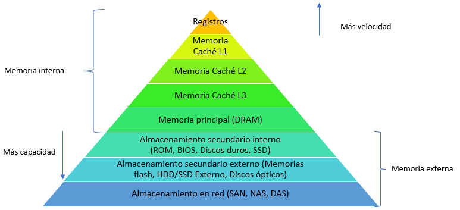

<em>Jerarquía de memoria: registros, caché L1, L2, L3, RAM y almacenamiento</em>

En un sistema informático tenemos diferentes tipos de memoria:

- **Registros**: las memorias más rápidas del ordenador; se encuentran en el procesador.
- **Memoria RAM**: la memoria principal del ordenador. Es volátil y se mide en B/GB.
- **Caché**: memoria que sirve de puente entre la memoria principal y el procesador, aumentando la velocidad del sistema. También es volátil.
- **RAM-CMOS**: memoria de bajo consumo y volátil.
- **ROM** (*Read Only Memory*): memoria no volátil pero más lenta. No es cierto que no se pueda escribir, pero está pensada para ser leída.

### 3.1 Memoria caché

Consiste en una memoria auxiliar empleada para **acelerar los accesos a la memoria principal** y así intentar compensar la diferencia de velocidad entre ella y el procesador.

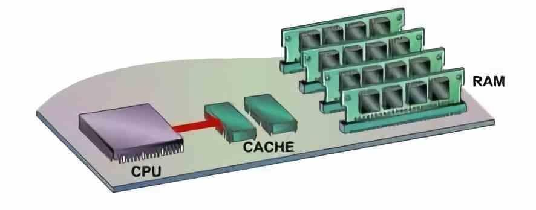

<em>La memoria caché entre la CPU y la memoria RAM</em>

Por limitaciones físicas, la mayoría de los datos que debe procesar la CPU no se encuentran dentro de ella, sino en otro conjunto de chips, la memoria RAM. Esto conlleva un cierto retardo en la comunicación entre ambos, y la memoria caché es la solución más utilizada para paliar este problema.

A un nivel básico, la caché es muy rápida y contiene un pequeño conjunto de instrucciones que el equipo usa con asiduidad para realizar sus tareas cotidianas. El equipo carga esas instrucciones en la caché mediante algoritmos complejos para acceder a ellas de manera inmediata, de modo que ese pequeño retraso entre la CPU y la RAM desaparece o se camufla.

Cuando el procesador intenta leer una palabra de memoria, comprueba si está en la caché. Si está (**acierto**), se entrega al procesador. En caso contrario (**fallo**), el bloque de memoria principal que contiene la palabra buscada se transfiere a la caché y, más tarde, la palabra se entrega al procesador.

#### 3.1.1 Niveles de caché

Los procesadores actuales cuentan con varios niveles de caché bastante diferenciados: normalmente L1, L2 y L3, y en algunos casos puntuales L4. Su configuración y características se han ido adecuando a las necesidades modernas.

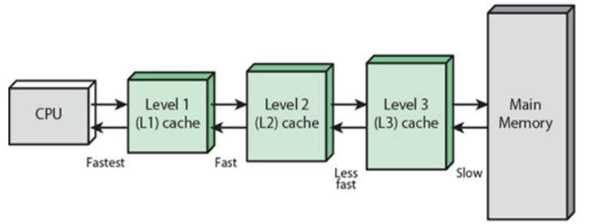

<em>Niveles de caché: de la CPU (más rápida) a la memoria principal (más lenta)</em>

- **Caché L1**: integrada en cada núcleo de forma independiente; es la más rápida, pero de menor capacidad. Normalmente se divide en dos bloques: uno para almacenar datos a tratar y otro para instrucciones.
- **Caché L2**: más lenta pero de mayor capacidad que la L1. Almacena datos de los niveles anteriores. En algunas arquitecturas se comunica con varios núcleos, por lo que es compartida y da coherencia a los núcleos. Algunas CPU pueden tener más niveles: por ejemplo, agrupar los núcleos en clústeres con una L2 en común y luego una L3 general; no es algo fijo.
- **Caché L3 o LLC** (*Last Level Cache*): mucho más lenta que las anteriores, pero de mayor capacidad. Es un espacio unificado y accesible para todos los núcleos de manera indistinta; almacena tanto datos como instrucciones. Es la caché de mayor capacidad y, al mismo tiempo, la más lenta. Existen procesadores con caché L4, pero es poco habitual.

#### 3.1.2 Funcionamiento

La caché no funciona igual que la RAM: no podemos hacer que la CPU se dirija a una dirección concreta dentro de la caché, porque lo que hace es **copiar los datos de la RAM cercanos a la dirección que la CPU está ejecutando en ese momento**.

Secuencia de uso: la utilidad de la caché es almacenar el segmento de RAM más cercano a donde está «mirando» el procesador. De manera preventiva copia un bloque de datos entero en el nivel de caché más alto y, mediante mecanismos relativamente complejos, mantiene la información que aún pueda ser útil.

La búsqueda no empieza en la RAM, sino en la caché más pequeña y cercana al procesador: se busca primero en la L1, luego en la L2 y así progresivamente hasta encontrar el dato. Si se encuentra en la caché, habrá tardado menos ciclos de reloj. Por ello, un procesador con una caché recortada siempre tendrá peor rendimiento. Este era precisamente el problema que se encontró en los años 80 y el motivo por el que se creó la caché: si cada vez que el procesador ejecuta una instrucción tuviera que esperar un nanosegundo de tiempo de acceso, la suma sería una enorme pérdida de rendimiento.

### 3.2 Memoria RAM

La **RAM** (*Random Access Memory*, memoria de acceso aleatorio) sirve para dotar al sistema de un espacio virtual necesario para manejar información y resolver problemas en cada momento. Es la memoria principal de un dispositivo, y en ella se almacenan de forma temporal los datos de los programas que estás utilizando en este momento. Se puede encontrar en cualquier dispositivo, desde ordenadores de sobremesa hasta teléfonos móviles.

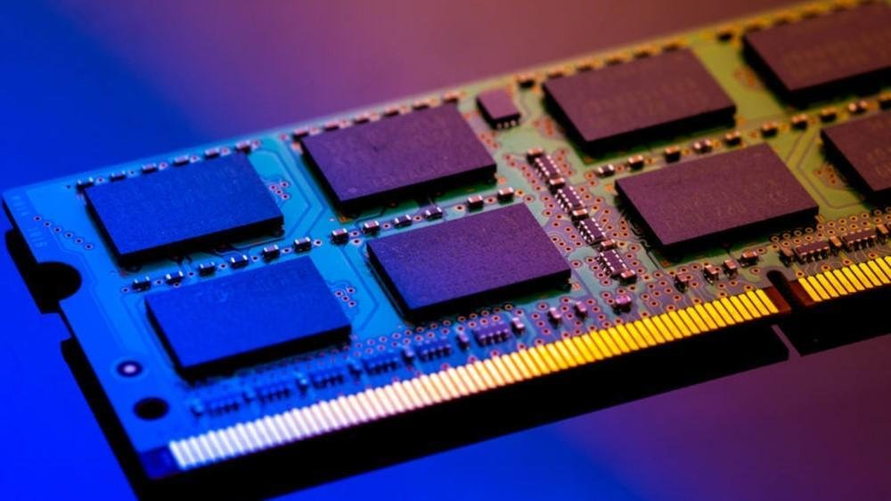

<em>Módulo de memoria RAM</em>

Hay que destacar que no es un sistema de almacenamiento como tal, ya que es **volátil**, pero guarda temporalmente información clave a la que el procesador debe acceder en un momento determinado. Lo que se intenta es reducir el impacto de rendimiento del procesador hacia distintos componentes, guardando información de alto valor en un sistema de alto ancho de banda y baja latencia, conectado de forma lógica al controlador de memoria integrado (IMC) de la CPU, con lo que el traspaso de información es constante y se carga y descarga cualquier dato en nanosegundos.

#### 3.2.1 Tipos de memoria

**RAM** (*Random Access Memory*): memorias formadas por semiconductores. Se distinguen varios tipos:

**DRAM (Dynamic RAM)**: memoria de lectura/escritura formada por **condensadores** (uno por bit) que se descargan cada cierto tiempo, por lo que es necesario leer el bit antes de que se pierda y regrabarlo o refrescarlo. Este ciclo se llama **ciclo de refresco**.

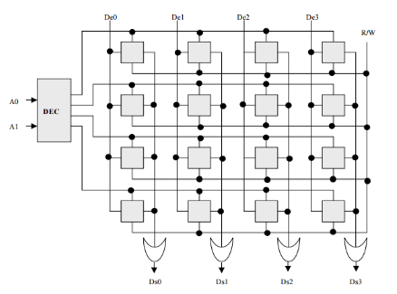

<em>Matriz de celdas de una memoria DRAM: filas (RAS) y columnas (CAS)</em>

- No se puede acceder a la información mientras se está refrescando.
- Es necesaria una operación de refresco para no perder la información.
- Tiene dos estados: estable e inestable.
- Almacena la información con un condensador y un transistor MOS (que forman la celda de memoria).
- Está formada por una rejilla bidimensional (matriz) de bits: cada columna se llama **CAS** y cada fila, **RAS**. La intersección de CAS y RAS son las celdas de memoria.
- Funcionamiento: se manda la carga al selector CAS y así se activa el transistor de cada bit de la columna. Para escribir, las filas tendrán el nuevo estado en función de la carga. En la lectura se tiene en cuenta el valor de la carga del condensador: menos del 50 % → 0; más del 50 % → 1.

**SRAM (Static RAM)**: también de lectura y escritura, pero **no necesita ser refrescada**, ya que se basa en semiconductores biestables que se autoalimentan y mantienen su estado mientras no se interrumpa la alimentación. Es un tipo de memoria más fiable.

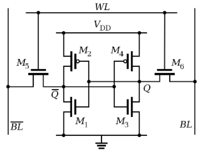

<em>Celda de memoria SRAM de seis transistores (biestable)</em>

- Tiempo de acceso entre 10 y 30 ns.
- Está formada por un circuito *flip-flop*: fluye la corriente de un lado a otro en función de cuál esté activado.
- Requiere un gran número de transistores, lo que la hace más voluminosa y disminuye la capacidad por chip.
- Ventajas: sin refresco y más rápida. Desventaja: más cara.

### 3.3 Tipos de memorias en el mercado

Las generaciones de memoria se distinguen por su velocidad, sus contactos y su voltaje. La DDR se utiliza para velocidades FSB de 266, 333 o 400 MHz y la DDR2 de 533 en adelante; según la velocidad FSB del procesador elegiremos una u otra, ya que los zócalos donde se insertan son distintos.

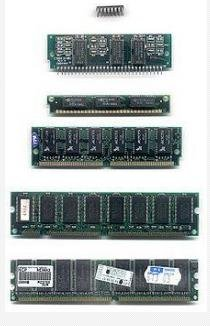

<em>Módulos de memoria de distintas épocas</em>

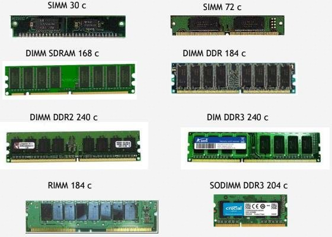

<em>Tipos de módulos: SIMM 30 y 72 contactos, DIMM SDRAM, DDR, DDR2, DDR3, RIMM y SODIMM</em>

| Generación | Descripción |
| ---------- | ----------- |
| DIMM SDRAM | Dos muescas, 168 contactos, 3,3 V |
| DDR | 2 palabras por ciclo; 266/333/400 MHz (PC2100/2700/3200); 184 contactos |
| DDR2 | 4 palabras por ciclo; 400/533/667/800 MHz (PC2-3200/6400); 1,8 V; 240 contactos |
| DDR3 | 8 palabras por ciclo; 800/1066/1333/1600 MHz (PC3-6400/8500/10600/12800); 1,5 V; 240 contactos |
| DDR4 | Intercala lecturas; 1,2 V; 1600-3200 MHz; 288 contactos |
| DDR5 | 1,1 V; 288 contactos (con muesca distinta a DDR4) |

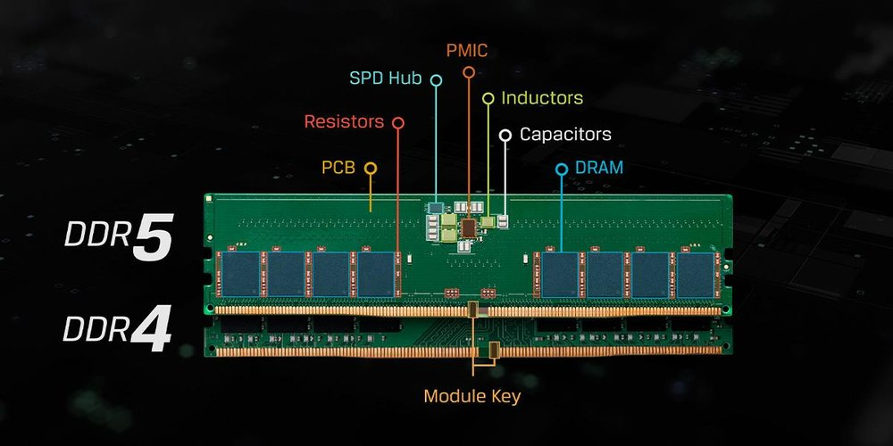

<em>Comparación de un módulo DDR5 y un módulo DDR4</em>

#### 3.3.1 HBM2

Es el tipo de memoria adoptado por AMD e Hynix, originalmente diseñada para tarjetas gráficas y dispositivos de red. AMD la usa como VRAM en sus tarjetas gráficas. **HBM** logra un mayor ancho de banda consumiendo sustancialmente menos que DDR4 y GDDR5. Esto se logra **apilando** hasta 8 *dies* de DRAM.

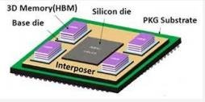

<em>Memoria HBM apilada sobre un interposer de silicio</em>

- HBM2 es la segunda generación; HBM2E, su evolución.
- Con una frecuencia de 1,2 GHz y un voltaje reducido de 1,2 V.
- Con 8 canales y un bus de 1024 bits, logra velocidades de 3,2 gigatransferencias por segundo.

#### 3.3.2 Optane

**Intel Optane** es un tipo de memoria intermedia para PC que, a efectos prácticos, actúa como una **caché entre la CPU y el disco duro**, acelerando los accesos al disco. Está pensada principalmente para acelerar los discos duros magnéticos rotatorios: combinando un HDD con una memoria Optane se tiene un rendimiento similar al de un SSD. Actualmente se ha quedado obsoleta y ha dejado de desarrollarse debido a los SSD.

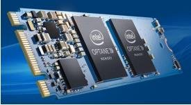

<em>Módulo Intel Optane</em>

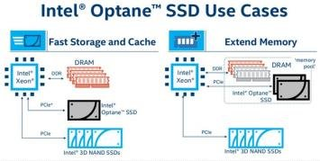

<em>Casos de uso de Intel Optane: almacenamiento/caché rápidos y ampliación de memoria</em>

### 3.4 Parámetros fundamentales

- **Velocidad de acceso**: expresada en nanosegundos; tiempo que tarda el sistema en acceder a la memoria.
- **Velocidad de reloj (frecuencia efectiva)**: frecuencia de trabajo del reloj interno de la memoria.
- **Latencia**: tiempo que tarda la RAM en atender una petición de la CPU. Al ser una matriz, se siguen estos pasos: selección de la fila (RAS, *Row Access Strobe*), selección de la columna (CAS), carga de la siguiente fila y envío de datos para escribir o leer en RAM.
  - El fabricante ofrece el dato de **CAS o CL** (*CAS Latency*): con CL 9 hay que esperar 9 ciclos de reloj para acceder a la columna.
- **Capacidad**: cantidad de información que puede contener.
- **Tiempo de acceso**: tiempo máximo que se tarda en leer o escribir el contenido de una posición de memoria.
- **Ancho de banda**: cantidad de información que puede transferirse simultáneamente y con continuidad por los distintos canales (MB o GB). En las DDR actuales se calcula como 8 bytes × velocidad de reloj.
- **Voltaje**: tensión necesaria para alimentar la memoria: DDR2 – 1,8 V; DDR3 – 1,5 V; DDR4 – 1,2 V; DDR5 – 1,1 V.
- **ECC** (*Error Checking and Correction*): memorias capaces de detectar errores al realizar el cambio de bits. Suelen usarse en servidores.

#### 3.4.1 Cálculos con la RAM

**Fórmulas:**

- Tasa de transferencia = ancho del bus (8 bytes) × frecuencia efectiva (MHz)
- Frecuencia real (velocidad del reloj de E/S) = frecuencia efectiva (velocidad del bus) ÷ accesos por ciclo
- Frecuencia efectiva (MHz) = frecuencia real × accesos por ciclo

Sustituyendo: tasa de transferencia = ancho del bus (8 bytes) × frecuencia real × accesos por ciclo.

| Tipo de memoria | Nombre estándar | Nombre del módulo | Accesos/ciclo |
| --------------- | --------------- | ----------------- | ------------- |
| DDR2 | PC2 | DDR2 | 4 |
| DDR3 | PC3 | DDR3 | 8 |
| DDR4 | PC4 | DDR4 | 8 |
| DDR5 | PC5 | DDR5 | 8 |

!!! example "Ejemplo 1: módulo DDR3-1600"
    ¿Nombre estándar, tasa de transferencia y velocidad de reloj real?

    - Tipo de RAM: DDR3 → PC3; accesos por ciclo: 8; frecuencia efectiva: 1600 MHz; ancho de bus: 8 bytes.
    - Tasa de transferencia = frecuencia efectiva × ancho de bus = 1600 MHz × 8 bytes = **12 800 MB/s** → nombre estándar **PC3-12800**.
    - Velocidad de reloj del bus = frecuencia efectiva ÷ accesos por ciclo = 1600 ÷ 8 = **200 MHz**.

!!! example "Ejemplo 2: módulo PC3-19200"
    ¿Frecuencia de reloj real?

    - Tipo de RAM: DDR3 → 8 accesos por ciclo; tasa de transferencia: 19 200 MB/s; ancho de bus: 8 bytes.
    - Frecuencia efectiva = tasa de transferencia ÷ ancho de bus = 19 200 ÷ 8 = **2400 MHz**.
    - Frecuencia real = frecuencia efectiva ÷ accesos por ciclo = 2400 ÷ 8 = **300 MHz**.

!!! task "Actividad"
    Calcula la tasa de transferencia y el nombre estándar de un módulo DDR4-3200, y la frecuencia efectiva y la frecuencia real de un módulo PC4-25600.

### 3.5 Componentes de un módulo de RAM

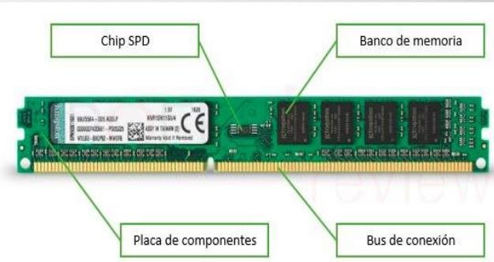

<em>Componentes de un módulo de RAM: chip SPD, banco de memoria, placa de componentes y bus de conexión</em>

- **Placa de componentes**: la estructura que soporta los demás componentes y las pistas eléctricas que comunican cada una de las partes.
- **Bancos de memoria**: los componentes físicos encargados de almacenar los registros. Están formados por chips de circuitos integrados compuestos en su interior por transistores y capacitores que forman celdas de almacenamiento.
- **Reloj**: las memorias RAM síncronas cuentan con un reloj que sincroniza las operaciones de lectura y escritura. Las asíncronas no llevan este elemento.
- **Chip SPD** (*Serial Presence Detect*): almacena los datos relativos al módulo: tamaño, tiempo de acceso, velocidad y tipo de memoria.
- **Bus de conexión**: contactos eléctricos que permiten la comunicación entre el módulo y la placa base.

### 3.6 Funcionamiento en Dual Channel

La tecnología de **doble canal** permite un incremento de rendimiento gracias a que es posible el acceso simultáneo a dos módulos distintos de memoria. Con *dual channel* activo se accede a bloques de **128 bits** en lugar de los 64 típicos. Para conseguirlo es necesario:

1. Un controlador de memoria adicional (situado en el puente norte de la placa base o, hoy, integrado en la CPU).
2. Módulos de memoria del mismo tipo, con la misma capacidad y velocidad.
3. Instalarlos en los slots indicados por la placa base (normalmente los pares 1-3 y 2-4).

Actualmente también se puede encontrar esta tecnología en triple canal o hasta cuádruple canal con las nuevas memorias DDR4.

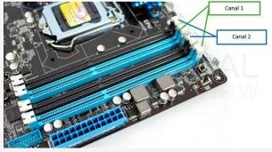

<em>Ranuras de memoria en dual channel: Canal 1 y Canal 2</em>

## Ejercicios prácticos

!!! task "Tarea"
    **Ejercicio 1**. Explica qué es un transistor y cómo, a partir de transistores, se construyen puertas lógicas y circuitos integrados. ¿Qué significa que un procesador se fabrique en 7 nm?

    **Ejercicio 2**. Compara CISC, RISC y el enfoque híbrido. ¿Por qué ARM destaca en eficiencia energética y x86 en rendimiento?

    **Ejercicio 3**. Enumera las partes del microprocesador (encapsulado, caché, FPU, unidad de control, ALU, registros, iGP) y explica brevemente la función de cada una.

    **Ejercicio 4**. Explica la diferencia entre núcleos físicos e hilos. ¿Qué significa que un procesador sea «8C/16T» y qué tecnologías lo permiten en Intel y en AMD?

    **Ejercicio 5**. Un procesador funciona a 1,3 V y consume 104 W. ¿Qué intensidad circula por él? Y otro con 1,2 V y 75 A, ¿qué potencia consume?

    **Ejercicio 6**. Explica qué es el *thermal throttling* y cuál es la diferencia entre TjMax, Tdie y TCase.

    **Ejercicio 7**. Explica en qué consiste el *overclocking*, qué requisitos hacen falta, qué riesgos tiene y qué es el *undervolting*.

    **Ejercicio 8**. Explica qué es un acierto y un fallo de caché, y por qué la búsqueda de un dato empieza siempre en la L1. Compara los tres niveles L1, L2 y L3.

    **Ejercicio 9**. Compara la DRAM y la SRAM en cuanto a funcionamiento, velocidad, coste y uso típico.

    **Ejercicio 10**. Calcula la tasa de transferencia y el nombre estándar de un módulo DDR4-3200, y la frecuencia efectiva y real de un módulo PC4-25600.

    **Ejercicio 11**. ¿Qué información almacena el chip SPD de un módulo de RAM y para qué se utiliza?

    **Ejercicio 12**. Explica qué es el *dual channel*, qué requisitos exige y en qué ranuras deben ponerse los módulos.

    **Ejercicio 13**. ¿En qué se diferencia la memoria HBM de la DDR? ¿Para qué se diseñó y por qué era interesante Optane?

    **Ejercicio 14 (práctica en el aula)**. Con una herramienta de información del sistema (por ejemplo, CPU-Z), identifica en un equipo del aula el modelo de procesador, número de núcleos e hilos, tamaño de las cachés L1/L2/L3, y tipo, capacidad, frecuencia y latencia de la RAM instalada.
